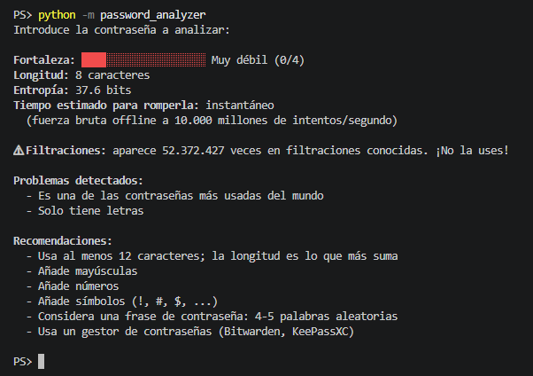

#  Password Analyzer

Herramienta de línea de comandos en Python que evalúa la fortaleza de una contraseña, estima cuánto tardaría un atacante en romperla y comprueba si ha aparecido en filtraciones de datos reales, **sin enviar nunca la contraseña a ningún servidor**.

  



##  Funcionalidades

- **Puntuación de fortaleza** de 0 a 4, con barra visual en color.
- **Cálculo de entropía** en bits según la longitud y el tipo de caracteres.
- **Tiempo estimado de crackeo** ante un ataque de fuerza bruta offline con GPU.
- **Detección de patrones débiles**: contraseñas comunes, secuencias (`1234`, `abcd`, `qwer`), caracteres repetidos y años.
- **Comprobación de filtraciones** con la API Pwned Passwords de [Have I Been Pwned](https://haveibeenpwned.com/), que reúne más de 900 millones de contraseñas filtradas.
- **Recomendaciones** concretas para mejorar la contraseña.
- Salida en **JSON** para integrarla en otros scripts.
- **Sin dependencias externas**: solo la librería estándar de Python.

## Privacidad: cómo funciona el k-anonimato

Enviar una contraseña a una API para saber si está filtrada sería un fallo de seguridad en sí mismo. Por eso la herramienta usa el modelo de **k-anonimato**:

```
Contraseña ──SHA-1──► 5BAA61E4C9B93F3F0682250B6CF8331B7EE68FD8
                      └─┬─┘└──────────────┬──────────────────┘
                     prefijo           sufijo
                  (se envía)     (nunca sale del equipo)
```

1. Se calcula el hash SHA-1 de la contraseña en local.
2. Solo se envían a la API los **5 primeros caracteres** del hash.
3. La API devuelve todos los hashes filtrados que empiezan por ese prefijo (cientos).
4. La comparación con el sufijo se hace **en local**.

Así, el servidor nunca sabe qué contraseña se ha consultado. Además, se envía la cabecera `Add-Padding` para que el tamaño de la respuesta no revele nada a quien espíe el tráfico, y la contraseña se introduce con `getpass` para que no quede ni en pantalla ni en el historial de la terminal.

##  Instalación

```bash
git clone https://github.com/JeanQuezadaC/password-analyzer.git
cd password-analyzer
```

No hace falta instalar nada más (Python 3.9 o superior).

##  Uso

```bash
python -m password_analyzer            # análisis completo
python -m password_analyzer --offline  # sin conexión a Internet
python -m password_analyzer --json     # salida en JSON
```

Ejemplo de salida:

```
Introduce la contraseña a analizar:

Fortaleza: ████████░░░░░░░░░░░░ Débil (1/4)
Longitud: 8 caracteres
Entropía: 47.6 bits
Tiempo estimado para romperla: 3 horas
  (fuerza bruta offline a 10.000 millones de intentos/segundo)

⚠ Filtraciones: aparece 1.204 veces en filtraciones conocidas. ¡No la uses!

Problemas detectados:
  - Contiene lo que parece un año (fácil de adivinar)

Recomendaciones:
  - Usa al menos 12 caracteres; la longitud es lo que más suma
  - Añade símbolos (!, #, $, ...)
  ...
```

##  Tests

```bash
python -m unittest -v
```

Los tests cubren el cálculo de entropía, la detección de patrones, el parseo de la respuesta de la API y verifican que **solo se envía el prefijo del hash** (k-anonimato).

## Estructura

```
password-analyzer/
├── password_analyzer/
│   ├── analyzer.py   # entropía, patrones débiles y puntuación (100 % local)
│   ├── hibp.py       # consulta a Have I Been Pwned con k-anonimato
│   └── cli.py        # interfaz de línea de comandos
└── tests/
    └── test_analyzer.py
```

## Qué he aprendido

- Por qué la **longitud** pesa más que la complejidad en la entropía de una contraseña.
- Cómo funcionan los **ataques de fuerza bruta y de diccionario**, y por qué una contraseña filtrada es insegura aunque sea compleja.
- **Funciones hash** (SHA-1) y el modelo de **k-anonimato** para consultar datos sensibles sin exponerlos.
- Consumo de **APIs REST** con la librería estándar y manejo de errores de red.
- Testing con `unittest` y **mocks** para no depender de servicios externos.

##  Limitaciones

- La entropía se calcula sobre el alfabeto usado, por lo que **sobreestima** la fortaleza de contraseñas basadas en palabras del diccionario. Herramientas como [zxcvbn](https://github.com/dropbox/zxcvbn) usan modelos más sofisticados.
- El tiempo de crackeo asume un hash rápido; con algoritmos lentos como bcrypt o Argon2 sería mucho mayor.

## Próximas mejoras

- [ ] Generador de contraseñas y frases de contraseña seguras.
- [ ] Detección de sustituciones típicas (`p@ssw0rd`).
- [ ] Análisis por lotes desde un archivo.
- [ ] Interfaz gráfica o web.

##  Aviso de uso ético

Herramienta creada con fines **educativos y defensivos**: para evaluar contraseñas propias y concienciar sobre buenas prácticas. No la uses para analizar credenciales de terceros sin autorización.

##  Licencia

MIT
